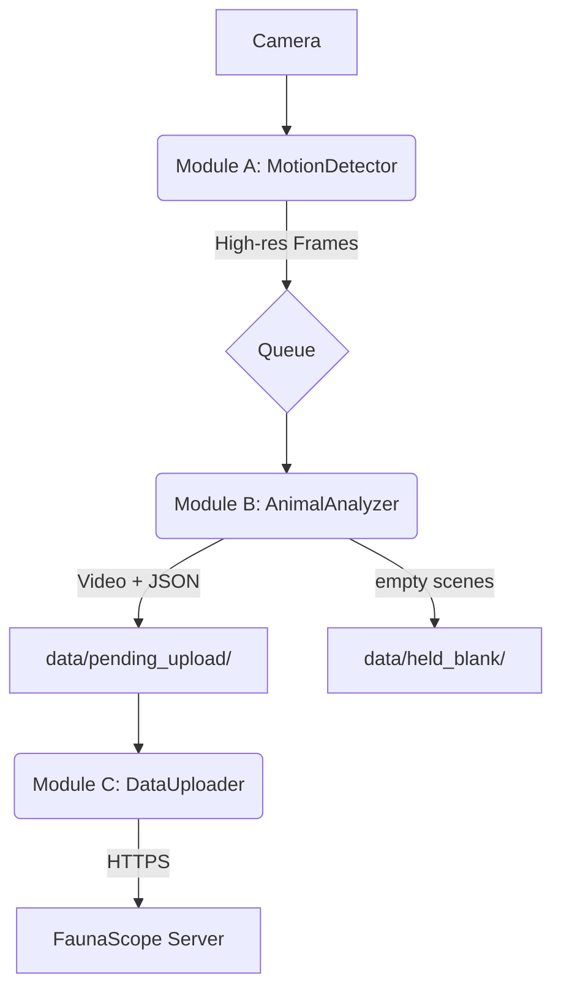

# FaunaScope-Edge

An intelligent, field-deployable animal monitoring system. FaunaScope-Edge runs on a camera node in the field, records video when something moves, keeps only the recordings that show animals or people, names the species, and uploads each event to the FaunaScope server for scientific research.

## Overview

This repository contains the software of the edge device in the FaunaScope project. It is designed for a power-constrained GPU computer (an NVIDIA Jetson Orin Nano) with a camera, and works as a pipeline of three modules:

1.  **Motion Detection:** A lightweight background-subtraction stage watches the camera continuously and starts an event when something moves.
2.  **Animal Analysis:** MegaDetector checks the event's frames for animals and people, and an optical-flow tracker follows its boxes between the frames it checks. When the event ends, SpeciesNet names the species of each animal it followed, and the event is saved as an MP4 video and a JSON metadata file.
3.  **Data Upload:** A background process sends each event to the server over HTTPS, in chunks that resume where an interrupted upload stopped, within a daily data budget.

The expensive models run only while something moves, and only events with a confirmed animal or person use the network.



## Key Features

-   **Efficient Motion Detection:** Adaptive background subtraction filters out slow changes in light, shadows, and small specks.
-   **Animal Detection:** MegaDetector V6 (`MDV6-mit-yolov9-c`), a camera-trap detector trained on millions of images from many ecosystems, runs on every fifth frame of a motion event and finds animals, people, and vehicles.
-   **Species Classification:** Google's SpeciesNet classifies each animal from several of its crops and accepts a species only where its geofence places it (here, Texas). Events in which it finds nothing but empty scenes are kept on the device instead of being uploaded.
-   **Resilient Data Upload:** Files stay on the device until the server confirms the whole event; network failures are retried with a growing delay, and a daily limit keeps a backlog from using up the data plan.
-   **Optional Live View:** A browser can watch the camera on demand, at no cost while nobody is watching.

## Quick Start

On a Jetson with Docker and the NVIDIA Container Toolkit:

```sh
git clone https://github.com/imics-lab/faunascope-edge.git
cd faunascope-edge
cp env.example .env        # camera, location, device ID, server URL, and device token
mkdir -p model_weight/speciesnet
for f in speciesnet.onnx labels.txt taxonomy.txt geofence.json version.txt; do
    curl -L -o model_weight/speciesnet/$f https://github.com/imics-lab/faunascope-edge/releases/download/speciesnet-v4.0.3a/$f
done
docker compose -f docker-compose-jetson.yml up --build -d
```

The first start converts both models for the GPU, which takes about 20 minutes on an Orin Nano. [Deployment](docs/deployment.md) covers prerequisites, configuration, the live view, and troubleshooting.

## Documentation

| Document | What it covers |
|---|---|
| [Overview](docs/README.md) | How an event is made, and the folders on the device |
| [Motion detection](docs/motion-detection.md) | Background subtraction, events, camera input, live view |
| [Animal analysis](docs/analysis.md) | MegaDetector, tracking, SpeciesNet, held events, speed on the Jetson |
| [Event metadata](docs/metadata.md) | The JSON file written for each event, and the hourly heartbeat |
| [Uploading](docs/uploading.md) | The upload protocol, retries, the daily budget, device tokens |
| [Models](docs/models.md) | Model sources, licenses, conversion, and validation |
| [Deployment](docs/deployment.md) | Installing and running the device with Docker |
| [Development](docs/development.md) | Tests, replaying recorded videos, helper scripts |

## Project Structure

-   **`main.py`**: The entry point that starts the three modules.
-   **`config/config.yaml`**: Algorithm settings. Per-device values and secrets go in `.env` (see `env.example`).
-   **`src/`**: The modules: `motion_detector/`, `animal_analyzer/` (MegaDetector, tracking, SpeciesNet, packaging), and `data_uploader/`.
-   **`model_weight/`**: MegaDetector (in the repository) and SpeciesNet (downloaded).
-   **`data/`**: Events waiting for upload (`pending_upload/`), uploaded (`uploaded/`), and held as empty (`held_blank/`).
-   **`scripts/`**: Model conversion, replay of recorded video, camera tests, and the live view server.
-   **`tests/`**: Unit tests, run with `pytest`.
-   **`docs/`**: The documentation.

## Models and Licenses

MegaDetector V6 (`MDV6-mit-yolov9-c`) is by Microsoft AI for Good (code MIT, weights CC BY 4.0, https://zenodo.org/records/15398270). SpeciesNet is by Google (Apache-2.0, https://github.com/google/cameratrapai). [Models](docs/models.md) gives the details.
