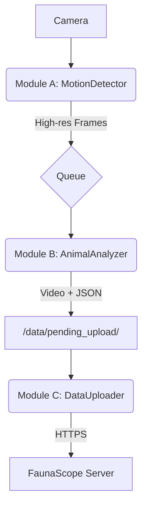

# FaunaScope-Edge

An intelligent, field-deployable animal monitoring system. FaunaScope-Edge uses a multi-stage AI pipeline to efficiently detect animal activity, capture high-quality video, and reliably upload significant events to a central database for scientific research.

## Overview

This repository contains the source code for the edge device component of the FaunaScope project. The system is designed to run on a power-constrained device (like a Jetson Nano Orin) deployed in the wild. It employs a three-module architecture to maximize efficiency and reliability:

1.  **Motion Detection:** A lightweight, low-power process continuously monitors a low-resolution video stream for any motion.
2.  **Animal Analysis:** When motion is detected, MegaDetector checks the event's frames for animals and people, and an optical-flow tracker follows its boxes between the frames it checks. When the event ends, SpeciesNet names the species of each animal it followed.
3.  **Data Upload:** If an animal or person is confirmed, the event (video and metadata) is packaged and handed to a resilient uploader that sends the data to a cloud server.

This approach ensures that the power-hungry GPU and network components are only activated when there is a high probability of a significant biological event, dramatically extending battery life.

## Key Features

-   **Efficient Motion Detection:** Uses adaptive background subtraction to filter out environmental noise like wind and changing shadows.
-   **Animal Detection:** Runs MegaDetector V6 (`MDV6-mit-yolov9-c`), a camera-trap detector trained on millions of images from many ecosystems, on every fifth frame of a motion event. It finds animals, people, and vehicles but does not name species.
-   **Species Classification:** Google's SpeciesNet classifies each animal from several of its crops, and accepts a species only where SpeciesNet's geofence places it (here, Texas). Events in which it finds nothing but empty scenes are kept on the device in `data/held_blank/` instead of being uploaded.
-   **Robust Data Packaging:** Confirmed events are saved as a pair: a high-quality MP4 video and a detailed JSON metadata file.
-   **Resilient Data Upload:** A background process sends each event to the FaunaScope server over HTTPS, in chunks that resume where an interrupted upload stopped. Files stay on the device until the server confirms the whole event, network failures are retried with a growing delay, and a daily limit keeps a backlog from using up the data plan.
-   **Modular Architecture:** The system is built with three independent processes that communicate safely, ensuring stability and responsiveness.

## Live View Feature (Optional)

The system includes an optional, on-demand live viewing feature. To use it, you must first set `enabled: true` in the `live_view` section of your `config.yaml`.

**Data Usage Note:** To prevent accidental high data usage on LTE connections, the live stream is limited by a timer (default 60 seconds). When the timer expires, the stream pauses and must be manually refreshed. You can adjust this limit via `stream_timeout_seconds` in `config.yaml`.

The main `FaunaScope-edge` application must be running for this feature to work.

### Local Viewing (On the Jetson Desktop)

This is useful for direct debugging. It reads the camera feed from the RAM disk.

1.  Start the main application in one terminal: `python main.py`
2.  Open a second terminal and run:
    ```sh
    python scripts/view_live_local.py
    ```
    A window will appear showing the live feed. Press 'q' to close it.

### Remote Viewing (Over the Network)

This runs a web server that streams the feed, allowing you to view it from a web browser on another computer.

1.  Start the main application in one terminal: `python main.py`
2.  Open a second terminal and run the stream server:
    ```sh
    python scripts/stream_server.py
    ```
3.  On any computer on the same network, open a web browser and navigate to `http://<JETSON_IP_ADDRESS>:8080`. For remote access from outside the local network, see documentation on setting up a VPN or a reverse SSH tunnel.

## System Architecture

The application operates as a pipeline of three independent modules communicating through a data queue and the local filesystem.



## Getting Started

FaunaScope-Edge is primarily intended to run in a Docker container on a CUDA-capable edge device. The Docker setup provides the expected runtime environment, GPU access, camera device mappings, persistent data directories, and the live-view service. See [`DOCKER.md`](DOCKER.md) for the full deployment guide.

### Prerequisites

-   An NVIDIA Jetson device (or a Linux PC with a CUDA-enabled GPU). **Note:** This application is computationally intensive and requires a CUDA-enabled GPU to run effectively. CPU-only execution is not supported due to poor performance.
-   A connected camera (USB webcam or CSI camera)
-   Docker and NVIDIA Container Toolkit installed on the target device
-   A device token from the FaunaScope server's administrator (see [Uploading to the Server](#uploading-to-the-server))

### Docker Deployment

1.  **Clone the repository:**
    ```sh
    git clone https://github.com/your-username/FaunaScope-edge.git
    cd FaunaScope-edge
    ```

2.  **Configure the application:**
    
    FaunaScope-Edge uses a two-layer configuration approach:
    
    -   **Hardware and credentials** (`.env` file):
        ```sh
        cp env.example .env
        nano .env  # Fill in your camera settings, device location, server URL, and device token
        ```
        The `.env` file is git-ignored and contains deployment-specific settings like camera resolution, the device token, and device location.
    
    -   **Algorithm parameters** (`config/config.yaml`):
        Edit this file to adjust motion detection thresholds, the detector's confidence threshold and trigger classes, and other algorithm settings. This file is safe to commit to version control.

3.  **Model weights:**
    The detector is `model_weight/MDV6-mit-yolov9-c.onnx`. It was made with `scripts/export_megadetector.py` from Microsoft's `MDV6-mit-yolov9-c.ckpt` (https://zenodo.org/records/15398270, CC BY 4.0; code MIT), the MegaDetector V6 variant trained with MultimediaTechLab's MIT-licensed YOLO code.

    The species classifier, Google's SpeciesNet 4.0.3a (Apache-2.0), is too large for the repository. Download it from this repository's releases into `model_weight/speciesnet/`:
    ```sh
    mkdir -p model_weight/speciesnet
    for f in speciesnet.onnx labels.txt taxonomy.txt geofence.json version.txt; do
        curl -L -o model_weight/speciesnet/$f https://github.com/imics-lab/faunascope-edge/releases/download/speciesnet-v4.0.3a/$f
    done
    ```
    The release holds the output of `scripts/export_speciesnet.py`, which converts the PyTorch release on Kaggle (`google/speciesnet/pyTorch/v4.0.3a/1`).

4.  **Run with Docker Compose:**
    ```sh
    docker compose -f docker-compose-jetson.yml up --build -d
    ```
    Use `docker-compose-jetson.yml` for Jetson devices and `docker-compose-gpu.yml` for generic NVIDIA GPU machines. See [`DOCKER.md`](DOCKER.md) for platform-specific prerequisites, volume mappings, logs, troubleshooting, and live-view details.

## Usage

For normal operation, run the application through Docker Compose on the target device:

```sh
docker compose -f docker-compose-jetson.yml up -d
```

The container starts the main application and stream server together. To view logs:

```sh
docker compose -f docker-compose-jetson.yml logs -f
```

To stop the application:

```sh
docker compose -f docker-compose-jetson.yml down
```

Running `python main.py` directly is mainly useful for local development or debugging outside the container, and requires manually installing the Python and system dependencies described by the Docker image.

## Uploading to the Server

The server accepts events only from registered devices. Its administrator registers each device with `flask device add <DEVICE_ID>`, which prints the device's token once. Put the token and the server's address in `.env`, with `DEVICE_ID` set to the registered name, and set `UPLOADER_ENABLED=true`:

```sh
SERVER_URL=https://faunascope.txst.edu
DEVICE_TOKEN=<the token>
```

To check the token before deploying, ask the server about an event it has never seen. A valid token gets `{"offset":0,"received":false}`; an invalid one gets `401`:

```sh
curl -H "Authorization: Bearer $DEVICE_TOKEN" $SERVER_URL/api/v1/events/event_20000101-000000_00000000
```

The uploader sends the oldest events first and moves an event to `data/uploaded/` only after the server confirms it. When the network or server is unavailable, it pauses for 1, 2, 4, ... minutes, up to an hour. An event the server rejects is retried three times, then deferred for a day; after three deferrals it gets a `.failed` marker next to its JSON in `data/pending_upload/`, and deleting the marker queues it again. Files are never deleted. Events in `data/held_blank/`, which SpeciesNet found empty, are not uploaded; to send one, move its JSON and MP4 to `data/pending_upload/`. The upload settings, including the daily limit (`daily_upload_limit_mb`, 800 MB by default), are in the `uploader` section of `config/config.yaml`, and the uploader's progress is kept in `data/pending_upload/.upload_state.json`.

## Project Structure

-   **`main.py`**: The main entry point that initializes and runs all modules.
-   **`config/`**: Contains the `config.yaml` file for all system settings.
-   **`src/`**: Contains the core source code for the application.
    -   `motion_detector/`: Module A for detecting motion.
    -   `animal_analyzer/`: Module B for MegaDetector, tracking, SpeciesNet, and data packaging.
    -   `data_uploader/`: Module C for handling cloud uploads.
-   **`data/`**: Default location for generated data.
    -   `pending_upload/`: Staging area for video/JSON pairs waiting to be uploaded.
    -   `uploaded/`: Archive for successfully uploaded files.
    -   `held_blank/`: Events SpeciesNet found empty, kept instead of uploaded.
-   **`scripts/`**: A collection of useful helper scripts for testing and debugging individual components.
-   **`tests/`**: Unit tests, run with `pytest` (see Development and Testing).

## Development and Testing

The `scripts/` directory contains tools to help test parts of the system in isolation:
-   `test_camera.py`: Verify that your camera is detected and working correctly.
-   `test_analyzer.py`: Run the animal analyzer on a video file as one motion event.
-   `export_megadetector.py`: Convert the MegaDetector checkpoint to the ONNX model the analyzer loads.
-   `export_speciesnet.py`: Convert SpeciesNet's PyTorch release to the ONNX model and files the analyzer loads.
-   `test_detector.py`: Test motion detection module functionality using a video file.

The unit tests in `tests/` run without a camera, a GPU, or a server. They need `ffmpeg` on the PATH and the Python packages in `requirements-dev.txt`:

```sh
pip install -r requirements-dev.txt
pytest
```
