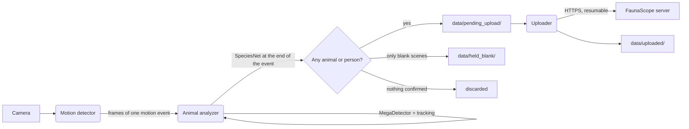

# FaunaScope Edge: Documentation

FaunaScope Edge is the software of a FaunaScope camera node: a small GPU computer (an NVIDIA Jetson Orin Nano) with a camera, deployed in the field. It watches the camera continuously, records a video when something moves, keeps the recording only if it shows an animal or a person, names the species, and sends the event (an MP4 video and a JSON metadata file) to the FaunaScope server over HTTPS. Everything runs on the device; the server only receives finished events.

## How an event is made

1. The **motion detector** compares each frame with a learned background on a small grayscale copy of the image. When enough of the image changes, it starts an event and passes every full-resolution frame to the analyzer until nothing has moved for `motion_cooldown_seconds`. See [Motion detection](motion-detection.md).
2. The **animal analyzer** runs MegaDetector on every fifth frame of the event and follows its boxes in between with optical flow. An event is kept once an animal or a person has been detected in two of those frames. When the event ends, SpeciesNet names the species of each animal it followed, the frames are encoded into an H.264 MP4, and the metadata is written next to it. See [Animal analysis](analysis.md) and [Event metadata](metadata.md).
3. The **uploader** sends finished events to the server, oldest first, in chunks that resume after an interruption, within a daily data budget. Files stay on the device until the server confirms the whole event. See [Uploading](uploading.md).

Once an hour, the main process also queues a heartbeat: how long the camera and the analyzer were running, how many motion events were discarded, held, or kept, and the device's state (see [Event metadata](metadata.md#heartbeat-format-version-1)).

The three modules run as separate processes, started by `main.py`. The motion detector and the analyzer share a `multiprocessing.Queue` of frames; the analyzer and the uploader share only the `data/pending_upload/` folder.

## Contents

| Document | What it covers |
|---|---|
| [Motion detection](motion-detection.md) | Background subtraction, the event state machine, camera input, and the optional live view |
| [Animal analysis](analysis.md) | MegaDetector, tracking, event significance, SpeciesNet, held events, memory use, speed on the Jetson |
| [Event metadata](metadata.md) | The JSON file written for each event (format version 2) and the hourly heartbeat, field by field |
| [Uploading](uploading.md) | The upload protocol as the device uses it, retries, the daily budget, and device tokens |
| [Models](models.md) | Where the two models come from, their licenses, how they are converted, and how they were validated |
| [Deployment](deployment.md) | Installing and running the device with Docker, configuration, and troubleshooting |
| [Development](development.md) | Tests, replaying recorded videos, and the helper scripts |

## Folders on the device

| Folder | Content |
|---|---|
| `config/config.yaml` | Algorithm settings (committed) |
| `.env` | Device settings and secrets: camera, location, server address, device token (never committed) |
| `model_weight/` | MegaDetector (in the repository) and SpeciesNet (downloaded, see [Models](models.md)) |
| `data/pending_upload/` | Finished events and heartbeats waiting for upload, and the uploader's state file |
| `data/uploaded/` | Events the server has confirmed |
| `data/held_blank/` | Events SpeciesNet found empty; kept, not uploaded |
| `data/temp_debug/` | With `debug_mode` on, the video parts already written to disk for events without a confirmed animal or person (see [Animal analysis](analysis.md#memory-and-video-encoding)) |
| `data/engine_cache/` | TensorRT engines built from the models on the first start |
| `logs/` | One log file per module |
